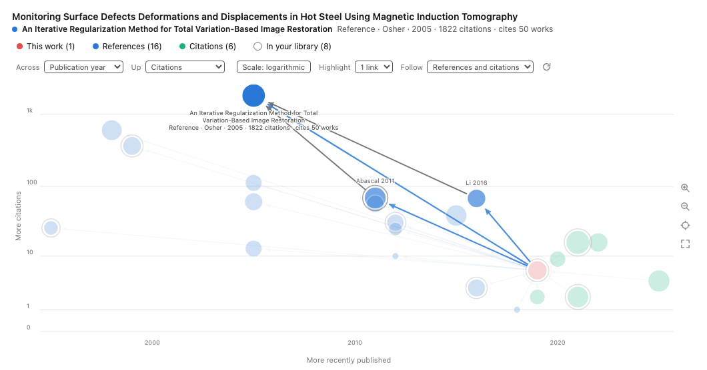
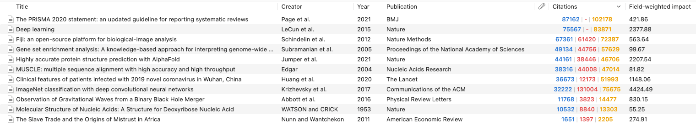
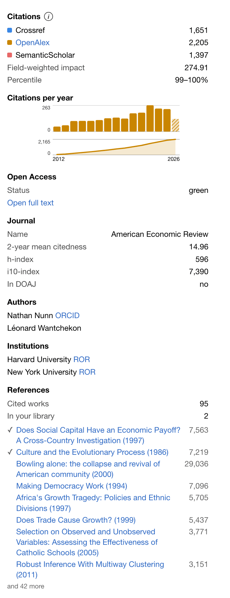

  

<h1 align="center">Orbit</h1>

  Citation counts, context and collection analysis for Zotero. 
  See how often a paper is cited and by whom, what your collection rests on, and what it is missing.

  
  
  
  

## Contents

- [Why Orbit](#why-orbit)
- [Features](#features)
- [Installation](#installation)
- [Quick start](#quick-start)
- [Settings](#settings)
- [Data sources and costs](#data-sources-and-costs)
- [Privacy](#privacy)
- [Limits and FAQ](#limits-and-faq)
- [Contributing](#contributing)
- [Credit](#credit)
- [License](#license)

## Why Orbit

Five sources disagree about how often a paper has been cited, and the
disagreement is often the interesting part. Web tools such as Connected Papers,
Inciteful or VOSviewer map the literature around a paper or a reading list, but
they do not know what is already in your library. Orbit works inside Zotero, so
it does: it shows the counts side by side, puts the record behind them in the
item pane, draws a paper's surroundings as a graph you can walk — and reads a
whole collection as one network, to tell you which works it rests on that you
do not have yet.

## Features

|                         |                                                                                                                                                   |
| ----------------------- | ------------------------------------------------------------------------------------------------------------------------------------------------- |
| **Citations column**    | Counts from Crossref, OpenAlex, Semantic Scholar, INSPIRE and Google Scholar side by side, plus a sortable field-weighted citation impact column. |
| **Item pane section**   | The OpenAlex record behind the numbers, and the paper's references, marked when you already hold them.                                            |
| **Paper graph**         | What a paper cites and what cites it, on axes you choose, with the citations among its neighbours.                                                |
| **Collection analysis** | A whole collection or library as one network, grouped into named clusters.                                                                        |
| **Gaps and import**     | The works your items lean on that you lack, ranked — and filed into the collection with one click.                                                |
| **Export**              | VOSviewer, Gephi (GraphML), CSV and RIS, and links into Local Citation Network and Inciteful.                                                     |

### Citations column

Counts from Crossref, OpenAlex, Semantic Scholar, INSPIRE and Google Scholar,
in the order you choose, each in its own colour, separated by `|`. Hovering a
cell says which number came from where.

A second, sortable column shows OpenAlex's field-weighted citation impact — how
a paper compares to others of its field, year and type, where 1.0 is average.
Above, it separates AlexNet from Watson and Crick: 4424 against 55, on 75,675
citations against 13,303. A raw count cannot say that. A `–` means that source
has no number for the work, not a count of zero.

### Item pane section

The same counts, spelled out and linked to their sources — the disagreement
above is real, and it is the ordinary case rather than a bad day. Then the
OpenAlex record: citations per year with a running total, the field-weighted
impact and its percentile, open-access status with a link to the full text,
journal metrics, authors with their ORCIDs, institutions with their RORs,
funding, and a retraction warning where there is one.

Underneath, the works this paper cites, from Semantic Scholar (which finds
consistently more of them than OpenAlex). A ✓ marks one you already hold, and
clicking it goes there; a ○ marks one you _probably_ hold (see
[how matching works](#how-does-orbit-know-what-i-already-have)).

### Paper graph

Right-click an item → **Citation graph**.

- **Both axes are yours to choose** — publication year, citations, or
  references cited; logarithmic or linear where the axis is a count.
- **Mark size** is how many works each one cites, so a review stands apart from
  a letter.
- **Arrows run from the citing work to the cited one**, so the direction of
  influence is drawn rather than inferred.
- **A ring** means the work is already in your library; a dashed ring, probably.
  The legend doubles as a filter.
- **Pointing at a mark** spells out its title and lights the paths between it
  and its neighbours — the citations _among_ the surrounding works, where a line
  of descent becomes visible.
- **Clicking a mark** opens a card with the full record, links to Semantic
  Scholar and the publisher, a button to open a graph from that work, and —
  for a work you do not hold — **Add to library**, which asks which collection
  it goes into.
- Scroll to zoom, drag to pan, Shift or Alt to stretch one axis alone.

### Collection analysis

Right-click a collection → **Citation graph**, or `Tools → Citation graph for
this library`.

Orbit looks up every item in the collection at OpenAlex and draws them as one
network:

- **Clusters.** Items that cite the same works are grouped (bibliographic
  coupling, Leiden algorithm) and each group is named after its most common
  OpenAlex topic. All clusters show at first; click one in the legend to show
  only that one, and click more to add them back one by one.
- **Shared references.** Works cited by at least two of your items appear
  beside them, and the citations between everything on screen are drawn.
- **Who cites your collection.** With an [OpenAlex API key](#settings), Orbit
  also finds works that cite at least two of your items.

Mark size grows with the number of references on a logarithmic scale, so
large and small papers stay comparable. The top ten gaps carry their rank as a
number on a thick ring, ranks 11–30 a thick ring, the rest a faint one.

Large collections are handled by a setting: above 300 items (adjustable),
Orbit either analyses the first 300, asks first with an estimate of the
requests it will make, or always analyses everything. The dialog and the note
under the graph show what is left of today's OpenAlex budget, as OpenAlex
reports it.

### Gaps and import

Beside the network, a list of the works your items lean on that your library
does not hold. Each is ranked by how many of your items cite it, divided by
`log10(10 + its citation count)` — so a niche work several of your items share
ranks above a classic everyone cites, while a work many of your items depend on
stays high however famous it is. Each entry names its authors and year, can
be sorted by score, year, citations or reference count, and expands to show
which of your items cite it.

A second view, **Most referenced**, lists every work at least two of your items
cite — held or not, including your own items that others in the collection
cite — so you see what the collection rests on, not only what it lacks.

**Import** files a work into the analysed collection through Zotero's own DOI
lookup, after asking. If the work is already somewhere in your library, it is
added to the collection instead of imported twice.

### Export

From the graph's export menu:

| Format         | For                                                                                                                             |
| -------------- | ------------------------------------------------------------------------------------------------------------------------------- |
| VOSviewer JSON | [VOSviewer](https://www.vosviewer.com/) and [VOSviewer Online](https://app.vosviewer.com/), with clusters and years             |
| GraphML        | [Gephi](https://gephi.org/) and other graph tools; keeps the direction of citations                                             |
| CSV            | The gaps list in a spreadsheet                                                                                                  |
| RIS            | The gaps as references, for any reference manager                                                                               |
| Links          | Open the collection in [Local Citation Network](https://localcitationnetwork.github.io/) or [Inciteful](https://inciteful.xyz/) |

## Installation

| Zotero  | Orbit                                                                                                                    |
| ------- | ------------------------------------------------------------------------------------------------------------------------ |
| 10      | [latest release](https://github.com/fkallmer/zotero-orbit/releases/latest)                                               |
| 7, 8, 9 | not supported — use [Citation Tally](https://github.com/daeh/zotero-citation-tally/releases), which Orbit is forked from |

1. Download `orbit.xpi` from the [latest release](https://github.com/fkallmer/zotero-orbit/releases/latest).
2. In Zotero: `Tools → Plugins`, then `Install Plugin From File…` from the gear icon ⛭.
3. Choose the file, and restart Zotero.

Orbit updates itself through Zotero's plugin updates.

## Quick start

1. If the **Citations** column does not appear, right-click the column headers
   and tick it.
2. New items get their counts as you add them. For existing items, select them,
   right-click and choose **Update Citation Tallies**, or run
   `Tools → Retally outdated item citations`.
3. Select an item and open the **Citation Details** section in the item pane.
4. Right-click an item or a collection → **Citation graph**.
5. Optional, but worth it: add a free [OpenAlex API key](https://openalex.org/)
   and a [Semantic Scholar API key](https://www.semanticscholar.org/product/api)
   in the settings.

## Settings

`Zotero → Settings → Orbit` on macOS, `Edit → Settings → Orbit` elsewhere.

| Setting                      | Default                     | What it does                                                                                                                                             |
| ---------------------------- | --------------------------- | -------------------------------------------------------------------------------------------------------------------------------------------------------- |
| **Databases**                | `crossref, semanticscholar` | Which sources to count from, and in what order. For physics, `inspire, crossref, semanticscholar` is usually better.                                     |
| **Fetch for new items**      | On                          | Counts are looked up as you add items.                                                                                                                   |
| **Automatic updates**        | Off                         | Refresh missing and outdated counts at the next start.                                                                                                   |
| **Outdated after**           | 6 months                    | 3, 6, 12 or 24.                                                                                                                                          |
| **Colours**                  | On                          | Each source gets its own colour when more than one is shown.                                                                                             |
| **Contact address**          | empty                       | Sent to Crossref and OpenAlex. Crossref gives faster, higher limits to requests that say who is making them; OpenAlex now goes by the API key instead.   |
| **OpenAlex API key**         | empty                       | Raises OpenAlex's daily budget tenfold and lets the collection graph find the works that cite your items. Free at [openalex.org](https://openalex.org/). |
| **Semantic Scholar API key** | empty                       | Without one you share an anonymous pool with every other client, so lookups are slower and fail more.                                                    |
| **Collection limit**         | 300, ask first              | Above this many items: analyse only the first N, ask first with an estimate, or always analyse everything.                                               |

## Data sources and costs

| Source                                               | Used for                                                                 | Cost to you                                                                                                                                        |
| ---------------------------------------------------- | ------------------------------------------------------------------------ | -------------------------------------------------------------------------------------------------------------------------------------------------- |
| [Crossref](https://www.crossref.org/)                | Citation counts                                                          | Free                                                                                                                                               |
| [OpenAlex](https://openalex.org/)                    | Counts, the item pane record, the graphs and the collection analysis     | Free within a daily budget: $0.10 without a key, $1 with a free key. A 300-item analysis uses about 40 requests, roughly 4% of the keyless budget. |
| [Semantic Scholar](https://www.semanticscholar.org/) | Counts, reference lists, influential citations                           | Free; an API key makes it faster                                                                                                                   |
| [INSPIRE](https://inspirehep.net/)                   | Counts for high-energy physics                                           | Free                                                                                                                                               |
| Google Scholar                                       | Counts; no API, so it is read from the result page and paced accordingly | Free                                                                                                                                               |

Every source paces itself, so a large update takes a while by design. Crossref
and INSPIRE start at one request per second and slow down on rate-limit errors;
Semantic Scholar waits at least 1 second between keyed requests and 3 without a
key, and respects `Retry-After`. OpenAlex requests are paced by the budget its
own response headers report. A source that comes up empty for an item is not
asked again for 7 days, then 30, 90 and 180.

Records and collection networks are cached on disk for 14 days. The graph's
reload button refetches.

## Privacy

Orbit sends only what a lookup needs, and only to the source that answers it:

- **Identifiers** (DOI, arXiv ID, PMID) of the items you look up, to the
  sources you enabled. Titles and authors are sent only to Google Scholar,
  which has no other way to search.
- **Your contact address**, if you set one, to Crossref and OpenAlex.
- **Your API keys**, each only to its own service, in a request header — never
  in a URL, so they do not appear in debug logs. Zotero stores them
  unencrypted in its preferences.
- **Nothing else.** No telemetry, no account, no server of Orbit's own.
  Citation counts are written to each item's Extra field; everything else stays
  in a local cache file (`orbit-cache.json` in the Zotero data directory).

The **Import** button and the **Local Citation Network** and **Inciteful**
links send DOIs to Zotero's DOI lookup and to those sites respectively, and only
when you click them.

## Limits and FAQ

### How does Orbit know what I already have?

A work counts as held when it shares a DOI, arXiv ID or PubMed ID with one of
your items — read from the DOI field, Archive ID, an arxiv.org URL, or `DOI:`,
`arXiv:` and `PMID:` lines in Extra. When no identifier matches, Orbit marks a
work as _probably_ held only if its normalized title is exactly equal, the year
is within one, and at least one author matches by surname and initial — and no
identifier on either side contradicts it. Two papers called "Deep Learning" are
not the same paper.

### Why is a paper missing a count, or the whole item pane?

Orbit looks work up by DOI or arXiv ID only. Journal articles and conference
papers usually carry one; web pages, theses and datasets often do not.

### Why are some clusters called "Cluster 3"?

A cluster is named after the OpenAlex topic most of its items share. When
OpenAlex has no topic for them, it gets a number.

### Why can I not switch on "works citing my collection"?

Finding them needs OpenAlex's paged search, which requires an API key. Add one
in the settings.

### What does the gap score mean?

How many of your items cite the work, divided by `log10(10 + citations)`. The
divisor is 1 for an uncited work, 2 at 90 citations and 3 at 1,000.

## Contributing

Bug reports and pull requests are welcome. See
[CONTRIBUTING.md](CONTRIBUTING.md) for building, testing and how the code is
laid out, and [CHANGELOG.md](CHANGELOG.md) for what changed in each release.

If you use Orbit in your research, GitHub's **Cite this repository** button
gives a citation from [CITATION.cff](CITATION.cff).

## Credit

Orbit is not written from nothing. Two projects carry much of what makes it
work, and both are named here because a licence file is a legal minimum and not
the same thing as saying who did the work.

### Citation Tally — Dae Houlihan

[daeh/zotero-citation-tally](https://github.com/daeh/zotero-citation-tally),
AGPL-3.0. Orbit is a fork of it and inherits its licence.

That project is the foundation: the citation-count column, the provider
framework the sources plug into, the rate limiting with its backoff ladder and
circuit breaker, the preferences, the storage in the item's Extra field, and
the build. Everything Orbit adds sits on top of it.

Added here: the OpenAlex and Google Scholar providers, the item pane section,
the reference list, the field-weighted-impact column, the graph tab, and the
collection analysis with its clusters, gaps, import and exports.

### Google Scholar Citation Count — Justin Ribeiro

[justinribeiro/zotero-google-scholar-citation-count](https://github.com/justinribeiro/zotero-google-scholar-citation-count),
MPL-2.0, included as `LICENSE-MPL-2.0`.

`src/modules/googleScholarClient.core.ts` is derived from it and stays under
MPL-2.0 while the rest of Orbit is AGPL-3.0; section 3.3 of the MPL expressly
allows that combination. The file was rewritten in TypeScript, but the
substance is that project's: which markers in Scholar's HTML identify a result
and its citation count, and the distinction between a page carrying a result
but no count, which means zero, and a page carrying no result at all, which
means unknown.

### Also

- [networkanalysis-ts](https://github.com/neesjanvaneck/networkanalysis-ts) by
  Nees Jan van Eck (MIT), the Leiden implementation behind VOSviewer, clusters
  the collection network; it uses
  [java-random](https://www.npmjs.com/package/java-random) (ISC).
- The guarded title match follows the rule of
  [Cita](https://github.com/zotero-cita/zotero-cita); the gap ranking follows
  [zotero-citation-graph](https://github.com/Jajaho/zotero-citation-graph).
  Both are reimplemented, not copied.
- Built on [zotero-plugin-scaffold and zotero-plugin-toolkit](https://github.com/windingwind)
  by windingwind. Related work worth knowing about:
  [ZoteroCitationCountsManager](https://github.com/FrLars21/ZoteroCitationCountsManager)
  by FrLars21 and [zotero-citationcounts](https://github.com/eschnett/zotero-citationcounts)
  by eschnett.

## License

GNU Affero General Public License v3.0, with one exception:
`src/modules/googleScholarClient.core.ts` is under the Mozilla Public License
2.0. See [`LICENSE`](LICENSE) and [`LICENSE-MPL-2.0`](LICENSE-MPL-2.0).
